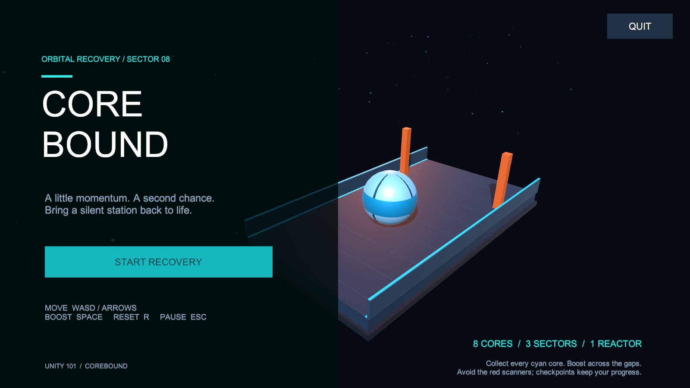

# Corebound

A small 3D physics game for Unity 101. Roll an energy sphere through an orbital station, recover eight cyan cores, and restore the orange reactor. Boost over two gaps, dodge moving red scanners, and use checkpoints to recover from mistakes.



## Play the Windows build

Download [Corebound-Windows.zip](Downloads/Corebound-Windows.zip), extract the whole archive, and run `Corebound.exe` inside `Corebound-Windows`. Keep the `_Data`, `MonoBleedingEdge`, `D3D12`, and DLL files beside the executable. The build uses the Mono scripting backend and requires no Unity editor to play.

## Open the project

- Unity Editor: **6000.0.23f1**, Built-in Render Pipeline.
- In Unity Hub, choose **Add > Add project from disk** and select this folder.
- Open `Assets/Scenes/MainMenu.unity` and press Play.
- Both `MainMenu` and `Game` are included in the Windows build settings.
- Game text is in English. No paid assets or extra installations are required beyond the Unity editor and its normal Unity UI package.

## Controls

| Input | Action |
| --- | --- |
| WASD / Arrow keys | Move on the X/Z plane |
| Space | Grounded directional impulse boost; 1.8-second cooldown |
| R | Return to the latest checkpoint |
| Escape | Pause / resume |
| Quit button | Exit the application; stop Play Mode in the editor |

Boost in the direction you are moving; with no movement it uses your last direction. Approach the orange-marked platform edge, then boost forward to cross. The ball does not have a separate jump. Red moving scanners reset the ball. All collected cores survive resets. To go back over a gap, face the opposite direction and boost.

## Course

1. **Arrival:** learn movement, weave around two baffles, collect three cores.
2. **The Gauntlet:** cross the first gap, link a checkpoint, avoid two moving scanners, collect three cores.
3. **Reactor Approach:** boost across the second gap, link another checkpoint, recover two cores, follow the narrow bridge to the reactor.

The reactor remains locked until all eight cores have been collected. There is no time limit; the timer and reset count give a replay target. Pause and victory panels include replay/menu actions, and the Quit button remains accessible.

## Implementation

| Requirement | Implementation |
| --- | --- |
| 3D game | Sphere Rigidbody, modeled platforms, rails and obstacles |
| Prefab instantiation | `CoreSpawner` instantiates `EnergyCore.prefab` in `Start` |
| Physics collisions | Dynamic player sphere, static deck/walls, kinematic scanner obstacles |
| Instant force boost | `PlayerController.TryBoost` calls `Rigidbody.AddForce` with `ForceMode.Impulse` |
| Live UI | Unity Canvas HUD updates cores, elapsed time, resets, cooldown and sector |
| Scene transition | Menu button loads Game; replay/menu actions load the appropriate scene |
| Audio | Six original generated WAV assets: five effects and looping ambience |
| Optional polish | Pickup bob/rotation, burst ParticleSystem, follow camera, glowing deck edges |

## Project layout

- `Assets/Scenes`: saved, editable menu and game scenes.
- `Assets/Scripts`: runtime gameplay, UI, and opt-in player verification.
- `Assets/Prefabs`: energy pickup and burst effects.
- `Assets/Materials`, `Assets/Textures`, `Assets/Audio`: original project assets.
- `Assets/Editor/ProjectBuilder.cs`: creates the initial assets/scenes and builds Windows.
- `Tools/generate_audio.py`: reproducible original audio synthesis using Python's standard library.
- `Verification`: build/import logs, actual player checks and screenshots when verification is run.

Change level geometry directly in the Game scene. Change core positions on the Core Spawner component. Change movement settings on the Player component. **Corebound > Generate Project Scenes** recreates the authored starter scenes, so use it only when intentionally rebuilding them; it replaces manual edits to those scenes. **Corebound > Build Windows** builds the currently saved scenes without regenerating them.

## Build and verification

Use **Corebound > Build Windows** in the editor to create `Builds/Windows/Corebound.exe` and all companion files. Keep the entire Windows folder together.

The built player supports an opt-in verification argument:

```text
Corebound.exe -coreRunnerVerify ABSOLUTE_OUTPUT_FOLDER -screen-width 1600 -screen-height 900 -windowed
```

This runs scene transitions, real Rigidbody flight across both gaps, checkpoint/collection/collision triggers, pause, victory, replay and menu checks. It writes a JSON report and screenshots, then quits. A normal launch starts the game without verification. See `Verification/TEST_REPORT.md` for recorded results and limitations.

## Asset provenance

All geometry, textures, effects and audio in this project were authored/generated specifically for Corebound. The UI uses Unity's built-in runtime font. Unity UI and engine modules are standard Unity dependencies. No third-party art, paid assets or downloaded music are included.

The two-page development post-mortem is available in [PDF](output/pdf/Corebound_PostMortem.pdf), with an [editable English source](Docs/CoreRunner_PostMortem.md) and [Chinese explanation](Docs/开发复盘_中文说明.md). It records an actual UI readability problem, an incomplete first fix, the final solution and verification limitations.

The complete Windows archive is included under `Downloads` for course submission and direct play. The Unity source, the two-page PDF and verification evidence are included in this repository.
